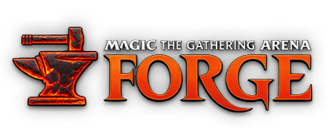
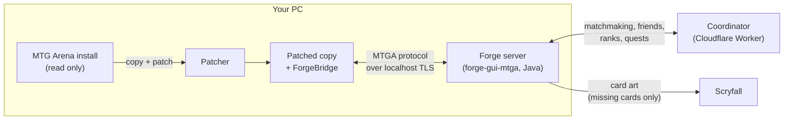

<div align="center">



**The client you know. A rules engine you can keep.**

Play Magic's competitive formats in your own copy of MTG Arena, with the open source [Forge](https://github.com/Card-Forge/forge) rules engine running every game.<br>
Every card is free. Every cosmetic is earned by playing. Nothing is ever sold.

[](https://github.com/Gerrard-Capashen/MTGA-Forge/releases/latest)
[](https://github.com/Gerrard-Capashen/MTGA-Forge/releases)
[](LICENSE)
[](https://discord.gg/xQSgHsEnQ)


[**Download**](https://mtgaforge.com) · [Features](#features) · [Install](#install) · [How it works](#how-it-works) · [FAQ](#faq) · [Contributing](CONTRIBUTING.md)

</div>

---

> **Unofficial fan project.** Not made, endorsed or supported by Wizards of the Coast, the makers of MTG Arena, or by Valve. No game files, code, art or audio are shipped or hosted here: the patched copy is made on your PC, from your own install.

## Features

| | |
|---|---|
| **Seven competitive formats** | Standard, Pioneer, Modern, Legacy, Vintage, Pauper and Premodern, ranked or casual, with ready-to-play decks for each |
| **Every card is free** | Every card in your collection, four copies each. No wildcards, no packs, no grind |
| **Ranked play** | Climb from Bronze to Mythic, then fight for a place on the Mythic leaderboard |
| **Best of three** | Full matches with sideboarding against the Forge AI or a friend; the loser of each game chooses to play or draw |
| **Drafts** | Premier Draft at one table with other players (including the Vintage Cube, Power Nine included); Quick Draft against Forge bots, offline |
| **Casual modes** | Brawl with your commander in the command zone, Momir Basic, and an Archenemy event against Sparky, the AI Archenemy |
| **Mastery track** | Every avatar, sleeve, companion, emote and title in the client, two rewards per level, earned by playing |
| **Daily quests** | Three a day, each with a free swap, all paying mastery XP |
| **Friends and challenges** | The client's own Friends list, invites, and direct challenges in every format, best of one or best of three |

It's an early project: expect rough edges and some missing or broken cards. Bugs, questions and opponents: [Discord](https://discord.gg/xQSgHsEnQ).

## Install

**You need**

- Windows 10 or 11
- MTG Arena on the same PC (the Steam version or the standalone installer). Start it once and sign in until the main menu, so it finishes downloading its game files (about 12 GB).
- About 15 GB of free disk space for the patched copy
- Nothing else: Java and the patch tools are bundled

**Steps**

1. Download the zip from **[mtgaforge.com](https://mtgaforge.com)** or the [latest release](https://github.com/Gerrard-Capashen/MTGA-Forge/releases/latest).
2. Check it against the SHA-256 and VirusTotal results shown under the download button:
   ```powershell
   Get-FileHash .\MTGA-Forge.zip
   ```
3. Unzip it anywhere and run `MTGA-Forge.exe`. The window walks you through it:
   1. It finds your MTGA install, or you pick the folder.
   2. You choose where the patched copy goes (default `%LOCALAPPDATA%\Programs\MTGA Forge`).
   3. It copies and patches the game, then builds the card database from your install. This takes a few minutes the first time and again after each MTGA update.
   4. You pick a name and press **Start**.

The launcher isn't code-signed yet, so Windows SmartScreen may warn the first time.

**Updates.** You download the zip once. When the launcher opens it checks GitHub for a newer release. If there is one, it shows **Update now**, which you press before playing: it downloads only what changed (usually a few MB), checks it, installs it and restarts itself. Updates are signed: the launcher installs nothing that wasn't signed with the project's release key. It never updates while the game is running. Your decks and identity live in `<folder>\data` and survive updates.

**Uninstall.** Press **Uninstall...** in the launcher and tick what to remove. Your MTGA install is never touched.

## How it works



- **The patcher** copies your MTGA install to a new folder and patches the copy's `Core.dll` with [Mono.Cecil](https://github.com/jbevain/cecil). The patched client talks to a server on your own PC instead of Wizards' servers, with telemetry and analytics switched off. Your original install is only read.
- **ForgeBridge** is a small library loaded into the patched client. It hosts the local login and lobby and smooths over the places where the client expects Wizards' backend.
- **The Forge server** is a module of a [Forge fork](https://github.com/Gerrard-Capashen/forge/tree/mtga). It speaks the client's own protocol: the lobby side (decks, events, drafts, inventory, cosmetics) and the game side (every game state, prompt and animation the client shows). Forge's engine referees every game, including the AI opponents and draft bots.
- **The coordinator** is a small Cloudflare Worker that introduces players to each other: matchmaking queues, friends, challenges, draft tables, ranks, the mastery track and quests. In an online match, one player's PC runs the game and the other connects through the coordinator. No router setup is needed. It never sees your MTGA account and stores no deck lists.
- **Card data** comes from your own install: the card database is built on your PC from the client's files. Art for cards the client lacks is fetched from Scryfall on demand.

More detail, with diagrams of a game, an online match and the trust model: [docs/architecture.md](docs/architecture.md).

## Privacy and safety

- The patched copy never signs in to MTGA's servers. Its network calls are switched off, and an optional setting adds a Windows Firewall rule that blocks it completely.
- Your identity is a key file in `<folder>\data\identity.json`, with no email or password. Use **Back up identity** in the launcher to keep your name on another PC.
- Each release is scanned on VirusTotal, and the results are published next to the download.
- When the game closes, the launcher blanks your Windows user name, computer name and IP addresses in the game's log, so a log you attach to a bug report doesn't carry them.

## FAQ

**Is this official?**
No. It's a fan project with no connection to Wizards of the Coast or Valve.

**Does it connect to MTGA's servers or touch my account?**
No. In our testing the patched copy sends nothing to Wizards: the only traffic is matchmaking and card art from Scryfall. It uses its own profile, separate from your real one.

**Do you redistribute the game?**
No. The download holds our code, Forge's engine and card scripts, and a Java runtime. Everything of the game is taken from your own install, on your own machine.

**Do both players need the same MTGA version?**
Yes. If you're told "different card database", one of you has another MTGA version or another MTGA Forge release.

**An MTGA update broke it.**
The launcher notices updates and patches again. If a new MTGA build moved something the patch depends on, it stops with an error and starts nothing. A new MTGA Forge release fixes that, usually quickly.

**Is it allowed?**
We can't speak for MTGA's terms of service. Use it at your own discretion.

## Why this exists

Games are sold as things you own, then switched off as services. [Stop Killing Games](https://www.stopkillinggames.com/) argues that a game shouldn't be left unplayable when support ends. Magic has already lost titles this way: Magic Duels (2019), Magic: Legends (2021) and Magic SpellSlingers (2024). MTGA Forge applies that idea to a game we like: with Forge, your games and decks keep working.

## Source and contributing

| Repository | What's in it |
|---|---|
| **this one** | patcher and ForgeBridge (C#), launcher (WPF), coordinator and website (TypeScript, Cloudflare Workers), build, test and release scripts, design notes |
| **[Gerrard-Capashen/forge](https://github.com/Gerrard-Capashen/forge/tree/mtga)**, branch `mtga` | the Forge fork; `forge-gui-mtga` is the game server |

Neither repository contains Wizards material. Developers generate what they need (the protocol schemas, a decompiled reference) from their own install with the scripts in `tools\`.

The project is large: four languages, a game client we don't control, and a rules engine with more than 30,000 cards. **Contributions are welcome, and AI coding agents are encouraged.** [CONTRIBUTING.md](CONTRIBUTING.md) explains the setup, the one hard rule, and how to work with an agent on this codebase.

## Credits

- [Forge](https://github.com/Card-Forge/forge) and its contributors: the rules engine, the AI and the card scripts that make all of this possible
- [Scryfall](https://scryfall.com/) for card art
- [Mono.Cecil](https://github.com/jbevain/cecil) for assembly patching
- Everyone on the Discord who reports bugs and finds opponents

## License

[GPL-3.0](LICENSE), the same license as Forge.

<sub>Magic: The Gathering, MTG Arena and related names are trademarks of Wizards of the Coast. This project is unofficial and provided as is, with no warranty. Built by players, for players.</sub>
