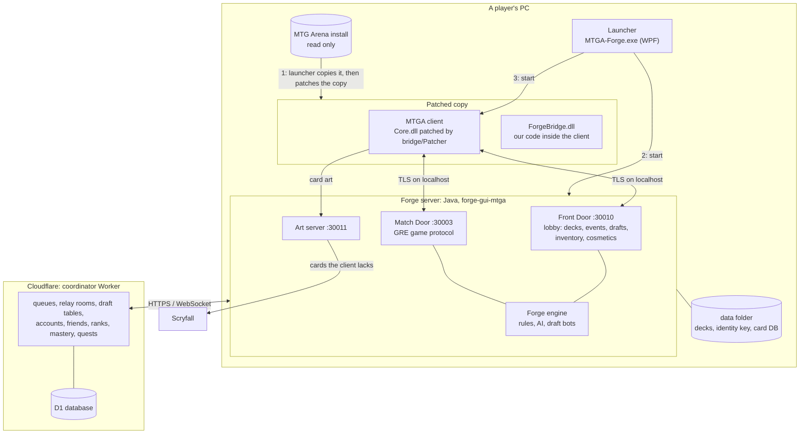
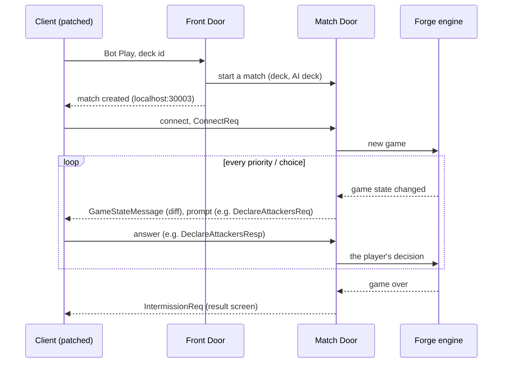
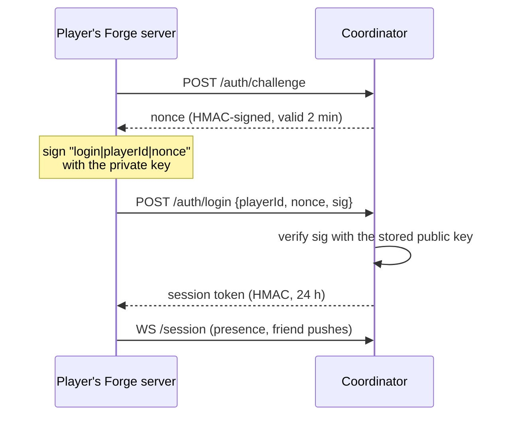
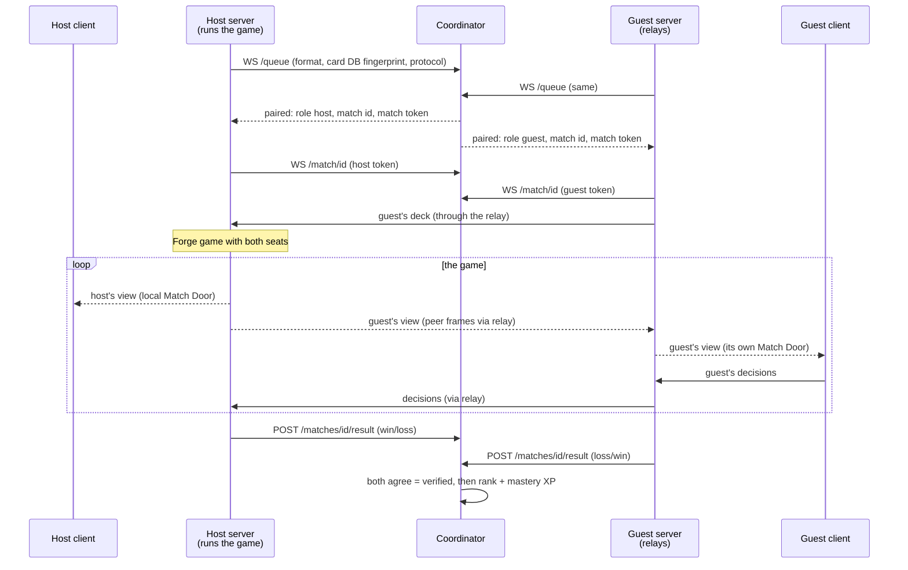
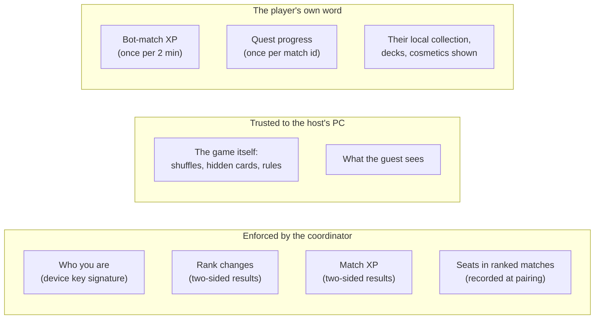

# How MTGA Forge works

A map for contributors: the pieces, how a game flows through them, how online play works, and what is and isn't protected. Details live in the code and in `docs/protocol.md`, `docs/profile.md` and `PROGRESS.md`.

## The pieces

- **Patcher** (`bridge/Patcher`, Mono.Cecil): copies the install (`tools/forge-patch.ps1` runs the steps) and rewrites methods in the copy's `Core.dll`. The client then trusts a self-signed `CN=localhost` certificate, uses the local Front Door instead of Wizards' servers, and has telemetry, analytics and the store switched off.
- **ForgeBridge** (`bridge/ForgeBridge`): C# loaded into the client. It provides the local login and account, the UI tweaks (formats, decks, mastery, queues, tooltips), and routes social features (friends, presence, challenges) to the coordinator.
- **Forge server** (`forge/forge-gui-mtga`): one Java process per player. The **Front Door** answers the client's lobby calls. The **Match Door** turns Forge's game state into the GRE messages the client renders, and the client's answers into Forge decisions. Each player's server keeps that player's decks and profile locally and signs in to the coordinator with the player's identity key.
- **Coordinator** (`coordinator/`): a Cloudflare Worker with Durable Objects and a D1 database. It never runs a game. It introduces players, relays their bytes, and keeps the shared records: accounts, friends, rank, mastery XP, quests.

## One game against the AI (offline)

Nothing leaves the PC except card art requests:

## Accounts and identity

There are no passwords. On first start the server creates a **device key** (ECDSA P-256) and stores it in `data/identity.json`. The coordinator only ever sees the public half.

Names are `Name#12345`: many players may share a name, and the tag makes each one unique. Ranked queues, results, friends, mastery and quests all key on the account from the session token, never on anything the client claims.

## An online match (peer to peer)

Each player runs their own Forge server, and one of them, the **host**, runs the actual game. The coordinator pairs the two and relays the bytes. It doesn't see inside the game and stores nothing about it apart from the reported result.

- Pairing needs the same queue, the same **card DB fingerprint** (same MTGA version and MTGA Forge release) and the same peer protocol version.
- The player who waited longest hosts. Draft tables work the same way: the first player at the table hosts the draft and the bots.
- **Results are two-sided.** Each seat reports its own outcome with its match token and session token, and a match counts only when both agree. With one report only: a reported loss is taken at its word, and a reported win counts only if the relay saw the opponent drop for good after 90 seconds of play. Contradicting reports are `disputed` and pay nothing (`coordinator/src/results.ts`).

### Why peer to peer, and not a hosted game server

A hosted game server would mean running a Java Forge process per live match: hundreds of MB of memory each, plus CPU for the rules engine and the AI. Cloudflare Workers can't run a JVM, so that would need a fleet of servers paid for every month. MTGA Forge sells nothing, by design, so there's no revenue to pay for it.

The relay costs a fraction of that: it only forwards bytes between two Durable Object WebSockets. **A hosted Forge server is out of the question for now; peer to peer remains the best option.** The door stays open for later, for example volunteer-run referee servers for ranked play. Nothing in the peer protocol prevents a third, neutral host.

## Fair play and identity: what is and isn't protected

The code is open, so anyone can build a modified client or server. Plan on that.

### Cheating

| Risk | Today | What can be done |
|---|---|---|
| **A modified host** sees the guest's hand and library, or rigs shuffles | Possible. The host's engine is the referee and sees everything. | No technical fix short of a neutral server. Commit-reveal seeds (each side commits a random value before the game; the shuffle uses both) would stop rigged shuffles but not peeking. Pick the host randomly at pairing instead of "longest wait" so a cheater can't choose to host. Rely on reports and reputation for ranked. |
| **Fake results** | Hard: both seats must agree. A lone win needs the opponent to really drop after 90 s. | Count disputes per account and flag or pause repeat offenders; add a report button (the client already has a report-player screen, `ReportPlayerReq`). |
| **XP farming** | Bot-match XP is the client's word, capped at one award per 2 minutes. Quest progress is the client's own counters, once per match id. | Low stakes: mastery only unlocks cosmetics, and every card is free. If it matters, add a daily cap on bot XP and count quest progress only for online matches the coordinator verified. |
| **Win trading** between two accounts of one person | Limited: only 3 ranked results a day between the same two accounts move rank; the rest are recorded with no change (`rank.ts`, `pair-cap`). Ranked rewards nothing beyond the leaderboard. | Watch the Mythic leaderboard by hand; lower the cap if trading shows up. |

The honest summary for players: **ranked is a friendly ladder, not a tournament.** It's protected against fake results, not against a determined cheater who hosts the game.

### Identity theft

- **Without the key file, nobody can act as you.** Logging in needs a signature from the private key, and the coordinator only has the public key. Session tokens are HMAC-signed, last 24 hours and are sent in headers, not URLs.
- **The key file is the account.** Anyone who copies `data/identity.json` (malware, a shared backup, a screenshot of its contents) becomes you. Planned hardening: encrypt the key at rest with Windows DPAPI (bound to the Windows user), protect backups with a passphrase, and add a "this key was stolen" flow that registers a new key using a recovery code shown once at registration.
- **Opponent names in online matches come from the coordinator.** Every queue (casual, ranked, Premier Draft matches) sends the session token. The coordinator then tells each side the other's account name, id and tag (`oppVerified`), whatever name the queue URL or the peer handshake claims (`coordinator/src/index.ts` `Queue`, `FrontDoor.vouched`). Challenges use the coordinator's friend record the same way. An opponent nobody vouches for, such as an older release that doesn't sign in for casual queues, is shown as `Name (unverified)` with no player id.
- **Developer accounts** (orange names) are set by hand in the database. The badge is looked up by the vouched player id, so a client can't claim it.
- **Still self-reported:** the opponent's rank badge and cosmetics shown on the versus screen come from their handshake. Names inside a Premier Draft pod come from the table's host (`coordinator/src/tables.ts` doesn't sign tickets in yet). Both only affect what's displayed; results and rank are unaffected.

## Where to look

| To change... | Start in |
|---|---|
| What the client is patched to do | `bridge/Patcher`, then `bridge/ForgeBridge` |
| Lobby behaviour (decks, events, drafts, rewards) | `forge-gui-mtga`: `forge.mtga.fd` |
| How a game looks in the client | `forge-gui-mtga`: Match Door and state sync (`forge.mtga.net`, `forge.mtga.forge`) |
| Online play | `forge-gui-mtga`: `forge.mtga.peer`; `coordinator/src/index.ts` and `tables.ts` |
| Accounts, ranks, XP, quests | `coordinator/src/*.ts`, migrations in `coordinator/migrations` |
